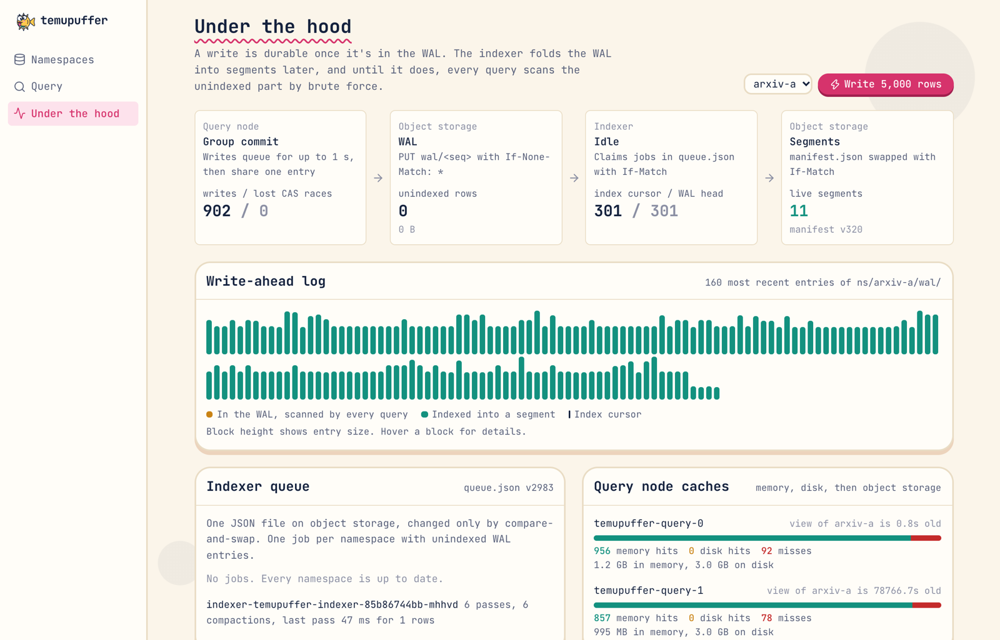
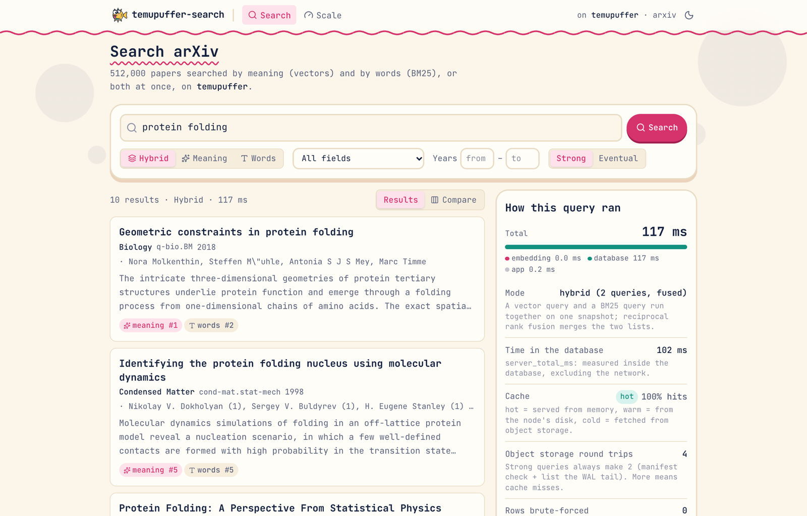
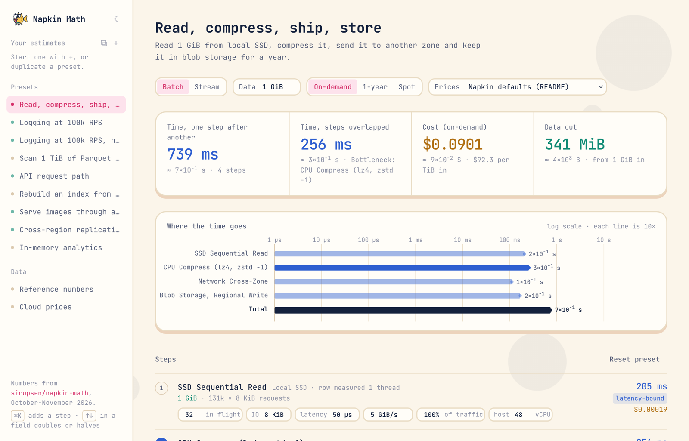

<p align="center"></p>

# temupuffer

Hello! I created temupuffer to learn how [turbopuffer](https://turbopuffer.com) works and the
technology underneath it. temupuffer uses object storage (S3) as its storage layer, plus write-ahead
logs, compare-and-swap, indexing and caching. I learn best by building things, so I went ahead and
built the core pieces myself.

It's a small database that works like turbopuffer. I went through their docs and their
[architecture diagrams](https://turbopuffer.com/docs/architecture) to see how everything is set up,
and built this so I could learn it hands-on.

When I started this, I didn't know what a vector was or how full-text search worked. Building temupuffer changed that. Now I
understand the problem turbopuffer solves and why its customers rely on it.

## How it works

- **The data only lives in object storage.** The pods don't have disks to lose. You can delete any
  pod and no acknowledged write is lost.
- **Writes go to a write-ahead log (WAL) first.** Each write is saved in the bucket before the API
  says "OK", using conditional PUTs so two writers can't overwrite each other.
- **A separate indexer** turns the WAL into search indexes in the background.
- **Queries use the index**, plus a quick scan of anything that isn't indexed yet, so new writes
  show up right away.
- **A console** lets you watch all of this happen.

```
 client ──► query node (×2) ──── PUT ns/<name>/wal/<seq>  If-None-Match: *  ───►  S3 bucket
             │  group commit, 1 entry/s                                            │
             │  strong query: check manifest (304?) + LIST WAL tail, scan tail     │
             ▼                                                                     │
          node cache (memory → disk → S3)                                          │
                                                                                   ▼
 indexer ◄── claim job in queue.json (If-Match) ── build segment ── swap manifest.json (If-Match)
```

## Why I built it

I built temupuffer to understand what turbopuffer is doing. Everything here comes from their public
docs and blog. Building each piece myself showed me why it's there: why the WAL comes first, why the
indexer runs on its own, why caching matters so much when your storage is S3.

Where their docs don't say how something works, I made my own choice and wrote down that it's mine.
So this is my version of the ideas, not how turbopuffer is actually built.
[docs/compat.md](docs/compat.md) lists which parts of the API match.

I run it on my [ansible-k3s-homelab](https://github.com/mipapi1/ansible-k3s-homelab), which turned
into a challenge of its own: my mini PCs can't handle any more workloads (lol). The next step is to
move it to Azure with my [azure-infrastructure](https://github.com/mipapi1/azure-infrastructure)
project.

You don't need a homelab to try it, though. You can run the whole thing on your own machine with
Docker, using one command: `./deploy/local.sh up`. Follow the [Quick start](#quick-start) below,
then the [walkthrough](docs/walkthrough.md) to see each piece working.

## What's inside

### temupuffer (the database + console)

The database itself, plus a console where you can watch it work. The "Under the hood" page follows a
write the whole way: the query node batches it, it lands in the WAL in object storage, and the indexer
folds it into segments (amber = not indexed yet, teal = indexed). Start with the
[walkthrough](docs/walkthrough.md).



### temupuffer-search (an app on top of it)

Once the database worked, I wanted to see what it's like to build a real app on top of it, the way
turbopuffer's customers do. So I built a search engine for 500,000 arXiv research papers. You can
search by words, by meaning (vectors) or both at once, and a "How this query ran" panel shows what
the database did: cache hits, trips to object storage, and time spent. It's also built to run on
real turbopuffer, which is my next test. More in [demo-app/](demo-app/README.md).



### Napkin Math UI (a calculator for the numbers)

turbopuffer's design starts from back-of-the-envelope math: how long a trip to S3 takes, and what a
GB costs on S3 vs SSD vs RAM. Their co-founder Simon Eskildsen keeps a list of those numbers in
[napkin-math](https://github.com/sirupsen/napkin-math). I turned it into a calculator: chain steps
together and see the time, the bottleneck and the cost, with real AWS, Azure and Google Cloud prices.
More in [napkin-math-ui/](napkin-math-ui/README.md).



## How it runs on my homelab

Every pod, which namespace it's in, and where the data lives. Blue is the only place data is
stored for good: any pod can be deleted without losing a write.


## Quick start

**On your machine** (needs Docker):

```bash
git clone <this repo> && cd temupuffer
./deploy/local.sh up          # prints http://localhost:3000 and the API key (tpuf-dev-key)
```

**On a K3s cluster** (needs kubectl + Docker), with its own S3 included:

```bash
./deploy/k3s.sh install                       # K3s on this machine, k3d or Docker Desktop: images are imported for you
./deploy/k3s.sh install --registry ghcr.io/you          # or push images to a registry your nodes can pull from
./deploy/k3s.sh install --import ssh:node1,node2        # or copy them to remote K3s nodes over SSH
```

Both print the console URL and the API key when ready. Options, uninstalling and using your own S3:
[deploy/README.md](deploy/README.md). Then follow [docs/walkthrough.md](docs/walkthrough.md).

**Choosing the object store.** One setting, `STORE`, picks the backend; nothing else in the engine changes:

| `STORE` | Backend | Configure with |
|---|---|---|
| `s3` (default) | Any S3-compatible store: SILO/MinIO, AWS S3 | `S3_ENDPOINT`, `S3_BUCKET`, `AWS_ACCESS_KEY_ID`, `AWS_SECRET_ACCESS_KEY` |
| `azure` | Azure Blob Storage (or the Azurite emulator) | `AZURE_STORAGE_CONNECTION_STRING` (or `AZURE_STORAGE_ACCOUNT_URL`), `AZURE_STORAGE_CONTAINER` |
| `memory` | In-process, for tests and UI work | nothing |

On Kubernetes, add the `deploy/components/azure-blob` component to an overlay to switch it to Azure
([deploy/README.md](deploy/README.md#azure-blob-storage-instead-of-s3)). Every pod runs a
compare-and-swap self-test against the store at startup and refuses to serve if it fails.

**Switching stores in the console.** Run one stack per store and give the console a `BACKENDS` list;
its sidebar then has a **Storage** picker (no credentials ever go through the browser):

```
BACKENDS="silo|SILO (S3)|temupuffer-query.temupuffer.svc.cluster.local:8080,azure|Azure Blob|temupuffer-query.temupuffer-azure.svc.cluster.local:8080"
```

Each entry is `id|label|host:port` and is served at `/b/<id>/api/`; `/api/` still goes to
`QUERY_UPSTREAM`. Same queries, different object store: a cold BM25 query took ~130 ms on in-cluster
SILO and ~630 ms on Azure from a home lab; warm, ~7 ms vs ~50 ms (two round trips to Azure).

**Load some data** (needs Python 3.11+; `make venv` creates `.venv`):

```bash
TEMUPUFFER_URL=http://localhost:3000/api .venv/bin/python scripts/load.py --docs 50000
TEMUPUFFER_URL=http://localhost:3000/api .venv/bin/python scripts/durability.py \
    --seconds 20 --kill-after 8 --kill-cmd "docker kill temupuffer-query-1"
```

**Developing:** `make test` runs the unit and API tests in-memory (~2 s). `make test-s3` runs the CAS and
WAL race tests against a real endpoint (`S3_ENDPOINT=...`). `STORE=memory make run-server` plus
`make ui-dev` give a hot-reloading console on :5173 with no Docker at all.

## Where things are

```
db/
  temupuffer/      the database itself (one Python package, used by both processes)
  server/          query node: the HTTP API (FastAPI)            → db/server/README.md
  indexer/         indexer process (loop + probe/stats endpoint) → db/indexer/README.md
  ui/              the console (React + Vite + Tailwind)         → db/ui/README.md
  tests/           pytest suite
deploy/
  local.sh  k3s.sh      one-command installs                     → deploy/README.md
  base/ components/ overlays/   Kustomize (overlays/k3s generic, overlays/agathla is my homelab)
  docker-compose.yml
scripts/
  load.py          write N docs, handle 429s, watch the backlog drain
  durability.py    kill a node mid-load, prove no acknowledged write was lost
napkin-math-ui/    napkin-math estimator: latency, throughput and cloud cost → napkin-math-ui/README.md
docs/
  concept-map.md   every temupuffer piece ↔ the turbopuffer concept + docs page
  compat.md        which parts of the API match turbopuffer and which don't
  object-storage.md  CAS on S3, GCS and Azure Blob
  walkthrough.md   what to click, what to watch, what it demonstrates
```

Start with [db/README.md](db/README.md) for the design, then [docs/concept-map.md](docs/concept-map.md).
